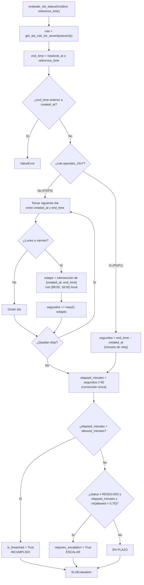

# ADR-002: Cálculo de SLA en horario hábil para severidades P2/P3

- **Estado**: Propuesto
- **Fecha**: 2026-11-14
- **Autor(es)**: [Nombre del Ingeniero / Equipo IncidentOps]
- **Componentes Afectados**: [`src/sla_calculator.py`, `src/incident_repository.py`]

---

## 1. Contexto y Problema

`evaluate_sla_status` (`src/sla_calculator.py:32`) calcula `elapsed_minutes` como la diferencia en **minutos de reloj** entre `created_at` y `resolved_at` (o `reference_time`), sin importar la severidad. Sin embargo, `SLA_POLICY_TABLE` define dos tipos de regla:

| Severidad | `max_resolution_minutes` | `operates_24x7` | Umbral de escalamiento (`int(max × 0.75)`) |
|-----------|--------------------------|-----------------|---------------------------------------------|
| P0        | 60                       | `True`          | 45                                          |
| P1        | 240                      | `True`          | 180                                         |
| P2        | 480                      | `False`         | 360                                         |
| P3        | 1440                     | `False`         | 1080                                        |

Para P2 y P3 (`operates_24x7=False`), el SLA solo debe consumirse durante el **horario hábil: lunes a viernes, 08:00–18:00**. El código actual lo ignora (ver `TODO(week-1-taller)`), y eso produce **falsos incumplimientos y escalamientos**. Ejemplo: un incidente P2 creado el viernes 2026-11-06 a las 17:30 y evaluado el lunes 2026-11-09 a las 07:30 registra **3720 minutos** transcurridos (incumplido, límite 480), cuando en horario hábil solo han pasado **30 minutos**.

El problema se propaga a `src/incident_repository.py:146`, que invoca `evaluate_sla_status` por cada incidente al construir los resúmenes de incidentes activos.

**Restricciones del sistema:**

- **Cero dependencias externas**: solo biblioteca estándar (`datetime`, `zoneinfo`).
- **Determinismo**: el mismo `Incident` y el mismo `reference_time` producen siempre la misma `SLAEvaluation`.
- **Compatibilidad**: no cambian las firmas de `evaluate_sla_status` ni de `SLAEvaluation`. P0/P1 deben comportarse exactamente igual que hoy.
- **Semántica de umbrales**: se conserva `>=` para escalar y `>` para incumplir.

---

## 2. Opciones Consideradas

1. **Opción A — Intersección de ventanas hábiles por día (O(n) en días)**:
   - *Ventajas*: Recorre cada día calendario entre inicio y fin, omite sábados y domingos, y suma el solape con `[08:00, 18:00)`. Una sola regla cubre noches, fines de semana, incidentes del mismo día y fronteras exactas, sin condicionales especiales. Acumula segundos y convierte a minutos una sola vez, así que no pierde precisión. Es fácil de leer y probar.
   - *Desventajas*: El costo es lineal en los días que abarca el incidente. Es despreciable en la práctica (un incidente abierto un año implica unas 365 iteraciones), pero no es O(1).

2. **Opción B — Mantener minutos de reloj para P2/P3 (código actual)**:
   - *Ventajas*: Sin cambios ni riesgo de regresión. Cálculo trivial O(1).
   - *Desventajas*: Es incorrecto para el negocio. Genera falsos incumplimientos y escalamientos cada noche y fin de semana (3720 min frente a 30 en el ejemplo).

3. **Opción C — Normalizar inicio y fin con casos especiales**:
   - *Ventajas*: Intuitiva. Mueve `created_at` al siguiente inicio hábil y `end_time` al fin hábil anterior, y luego resta.
   - *Desventajas*: Exige ramas separadas para "antes de las 08:00", "después de las 18:00", "fin de semana", "mismo día" y "fin antes que inicio tras normalizar". Cada rama es una fuente de errores. La intersección de la Opción A ya cubre todos estos casos de forma uniforme.

4. **Opción D — Fórmula O(1) por semanas completas**:
   - *Ventajas*: Costo constante: semanas completas × 3000 min, más el ajuste de los días parciales de los extremos.
   - *Desventajas*: Es aritmética modular sobre días de la semana, propensa a errores de uno en uno (off-by-one) en los bordes y difícil de auditar. Además complica la futura exclusión de festivos. **Se aplaza** salvo que una medición de rendimiento lo exija.

5. **Opción E — Intersección por día redondeando a minutos en cada día**:
   - *Ventajas*: Igual de simple que la Opción A.
   - *Desventajas*: Pierde hasta un minuto por cada día recorrido. Por ejemplo, lunes 17:59:30 → martes 08:00:30 suma 0 min en lugar de 1. El error se acumula en incidentes largos y puede mover un caso al otro lado de un umbral.

**Fuera de alcance — Festivos**: no se excluyen por ahora. El diseño de la Opción A admite añadir un conjunto de fechas inyectable (`holidays: frozenset[date]`) sin cambiar el algoritmo.

---

## 3. Decisión Arquitectónica

Se adopta la **Opción A — Intersección de ventanas hábiles por día**.

- **P0/P1 (`operates_24x7=True`)**: conservan el cálculo actual en minutos de reloj, sin cambios.
- **P2/P3 (`operates_24x7=False`)**: se recorre cada día calendario desde `created_at.date()` hasta `end_time.date()`, ambos incluidos. Para cada día de lunes a viernes se calcula el solape entre `[created_at, end_time]` y la ventana local `[08:00, 18:00)`, y se suma en **segundos** si es positivo. Sábados y domingos se omiten.
- **Conversión única**: `elapsed_minutes = int(total_seconds // 60)` se aplica una sola vez, al final, en ambas ramas.
- **Umbrales sin cambios**: `is_breached = elapsed_minutes > allowed`. `requires_escalation = status != "RESOLVED" and not is_breached and elapsed_minutes >= int(allowed × escalation_threshold_ratio)`. `remaining_minutes` pasa a expresarse en minutos hábiles para P2/P3.

**Por qué**: es la única opción correcta que cubre todos los casos con una sola regla, sin ramas especiales y sin pérdida de precisión. Respeta las restricciones de cero dependencias y determinismo. Su costo lineal en días es irrelevante para los volúmenes actuales.

Boceto de referencia (no normativo):

```python
from datetime import datetime, time, timedelta

BUSINESS_START = time(8, 0)
BUSINESS_END = time(18, 0)  # ventana semiabierta [08:00, 18:00)


def _business_seconds_between(start: datetime, end: datetime) -> float:
    """Suma los segundos de [start, end] que caen en lunes-viernes 08:00-18:00 (hora local)."""
    total = 0.0
    day = start.date()
    while day <= end.date():
        if day.weekday() < 5:  # 0 = lunes ... 4 = viernes
            window_start = datetime.combine(day, BUSINESS_START, tzinfo=start.tzinfo)
            window_end = datetime.combine(day, BUSINESS_END, tzinfo=start.tzinfo)
            overlap = (min(end, window_end) - max(start, window_start)).total_seconds()
            if overlap > 0:
                total += overlap
        day += timedelta(days=1)
    return total
```

Diagrama del cálculo y de la transición a escalamiento:



---

## 4. Consecuencias e Impacto

- **Positivas**:
  - Se eliminan los falsos incumplimientos y escalamientos de P2/P3 durante noches y fines de semana. Por ejemplo, 30 min en lugar de 3720 en el caso de viernes a lunes.
  - P0/P1 no cambian de comportamiento.
  - La precisión es exacta al segundo, con una sola conversión a minutos.
  - Se mantienen el determinismo y las cero dependencias, ya que `zoneinfo` es parte de la biblioteca estándar.
  - Las firmas públicas no cambian, así que `incident_repository.py:146` no requiere modificaciones.

- **Negativas / Trade-offs**:
  - El costo por evaluación de P2/P3 es O(días abarcados). En los resúmenes de `incident_repository.py` crece con la antigüedad de los incidentes abiertos. Es aceptable hoy. Si una medición lo justifica, se reevaluará la Opción D.
  - Los festivos no se excluyen todavía, así que un festivo entre semana consume SLA. Queda previsto un parámetro inyectable `holidays: frozenset[date]`.
  - Para P2/P3, `remaining_minutes` cambia de semántica: ahora son minutos hábiles restantes, no minutos de reloj. Los consumidores que lo muestren deben indicarlo.
  - **Pendiente — zona horaria de negocio**: hay que fijar una constante `BUSINESS_TZ = ZoneInfo("...")` (por ejemplo, `America/Bogota`) y convertir `created_at` y `end_time` con `astimezone(BUSINESS_TZ)` antes de intersectar. También hay que decidir la política para `datetime` ingenuos: interpretarlos en `BUSINESS_TZ` o rechazarlos con `ValueError`.

- **Verificación**:
  - **Actualizar el ejemplo/test de `src/sla_calculator.py:87`** (`monday_morning = 2026-11-09 09:00`). El valor esperado de `elapsed_minutes` debe recalcularse en minutos hábiles cuando el incidente de ejemplo sea P2/P3.
  - Pruebas unitarias deterministas (fechas de noviembre de 2026; el 2026-11-09 es lunes):

    | Caso | Severidad | Inicio → Fin | `elapsed_minutes` esperado |
    |------|-----------|--------------|----------------------------|
    | Mismo día hábil | P2 | mar 10:00 → mar 11:30 | 90 |
    | Cruce nocturno | P2 | lun 17:00 → mar 09:00 | 120 |
    | Fin de semana | P2 | vie 17:30 → lun 07:30 | 30 (hoy: 3720) |
    | Íntegro en fin de semana | P3 | sáb 10:00 → dom 20:00 | 0 |
    | Frontera de cierre | P2 | lun 18:00 → lun 18:30 | 0 |
    | Frontera de apertura | P2 | lun 08:00 → lun 08:01 | 1 |
    | Precisión en segundos (descarta la Opción E) | P2 | lun 17:59:30 → mar 08:00:30 | 1 |
    | 24×7 sin cambios | P1 | sáb 10:00 → sáb 11:00 | 60 |

  - Umbrales de P2: 359 min → sin escalar; 360 min → `requires_escalation=True`; 480 min → no incumplido; 481 min → `is_breached=True`. Con `status="RESOLVED"` nunca se escala.
  - `end_time < created_at` sigue lanzando `ValueError`.
  - Propiedad: para P2/P3, los minutos hábiles nunca superan los minutos de reloj del mismo intervalo.