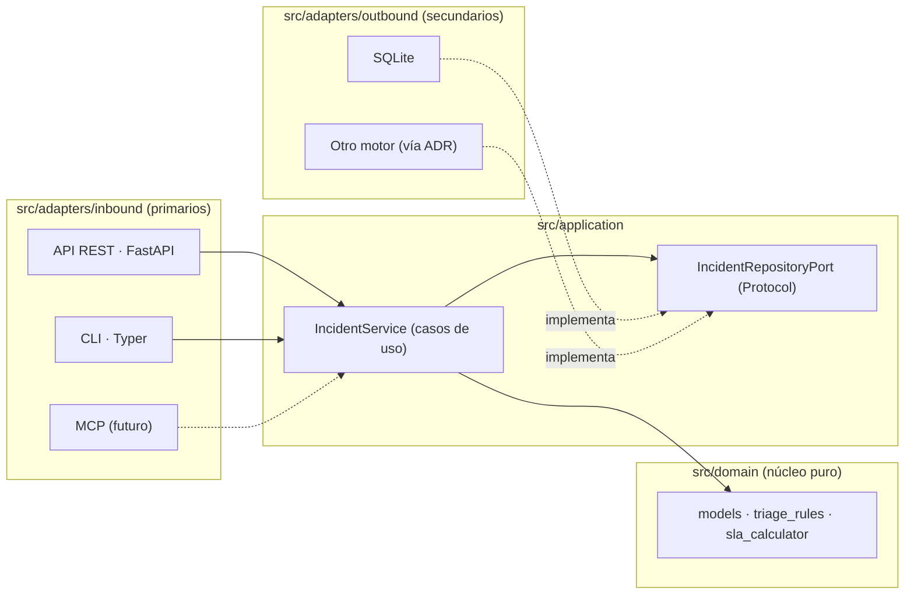

# ADR-003: Adopción de Arquitectura Hexagonal (Puertos y Adaptadores) para IncidentOps

- **Estado**: Aceptado
- **Fecha**: 2026-11-23
- **Autor(es)**: Equipo IncidentOps
- **Reemplaza a**: —

---

## 1. Contexto y Problema

Hasta la Semana 1, IncidentOps era un conjunto de módulos planos en `src/` (reglas de triaje, cálculo de SLA y un repositorio SQLite) invocados desde scripts. El roadmap exige exponer **las mismas reglas** por varias interfaces (API REST para el dashboard, CLI para soporte y, a futuro, un servidor MCP para agentes) y cambiar el motor de persistencia en el Hito 004 sin reescribir la lógica.

Si cada interfaz invoca directamente las reglas y el driver de base de datos, las reglas de negocio (severidades P0–P3, SLA en horario hábil, clave de duplicados) se duplicarán en cada adaptador y quedarán acopladas a FastAPI y a SQLite. La decisión es estructural: define la dirección de las dependencias de todo el código posterior y es costosa de revertir.

**Restricciones**: Python ≥ 3.10 con `uv`; núcleo determinista y probable sin infraestructura; sin ORMs pesados (ADR-001).

---

## 2. Opciones Consideradas

1. **Opción A — Arquitectura en capas tradicional acoplada a FastAPI/SQLite**:
   - *Ventajas*: Menos archivos y menor curva de entrada; rutas FastAPI que llaman directamente a las reglas y a `sqlite3`; suficiente para una única interfaz HTTP.
   - *Desventajas*: La lógica de orquestación vive en los *handlers* HTTP, así que la CLI (y el futuro MCP) debe duplicarla o importar FastAPI; el dominio depende transitivamente del motor de BD; cambiar a otro motor obliga a tocar rutas y reglas; las pruebas de negocio requieren levantar HTTP y BD.

2. **Opción B — Arquitectura Hexagonal (Puertos y Adaptadores)**:
   - *Ventajas*: Núcleo puro en `src/domain/` (solo biblioteca estándar); casos de uso únicos en `src/application/` (`IncidentService`) que dependen de puertos `typing.Protocol` (`IncidentRepositoryPort`); adaptadores primarios intercambiables en `src/adapters/inbound/` (REST, CLI, futuro MCP) y secundarios en `src/adapters/outbound/` (SQLite hoy, otro motor mañana). Las fronteras son verificables estáticamente.
   - *Desventajas*: Más módulos e indirección para un servicio pequeño; exige disciplina (y tooling) para que nadie salte una capa; mapeo explícito entre DTOs de los adaptadores y entidades del dominio.

---

## 3. Decisión Arquitectónica

Se adopta la **Opción B — Arquitectura Hexagonal**. Es la única que permite cumplir el roadmap (multi-interfaz en H001/H002 y cambio de motor en H004) sin duplicar reglas: cada nueva interfaz o motor es un adaptador nuevo que reutiliza `IncidentService` e implementa o consume `IncidentRepositoryPort`. La dirección de dependencias apunta siempre hacia el dominio y se valida con análisis estático de importaciones.

---

## 4. Consecuencias y Trade-offs

- **Positivas**: Paridad garantizada entre interfaces porque comparten el mismo caso de uso; el dominio se prueba sin HTTP ni BD; el motor de persistencia se sustituye implementando un puerto; incorporar MCP no toca reglas de negocio.
- **Negativas / Trade-offs**: Mayor número de módulos y de mapeos DTO ↔ entidad; riesgo de "fugas" de capa si no se automatiza su verificación (se asume el costo de mantener reglas de importación por capa); curva de aprendizaje para quien llega desde un diseño en capas.
