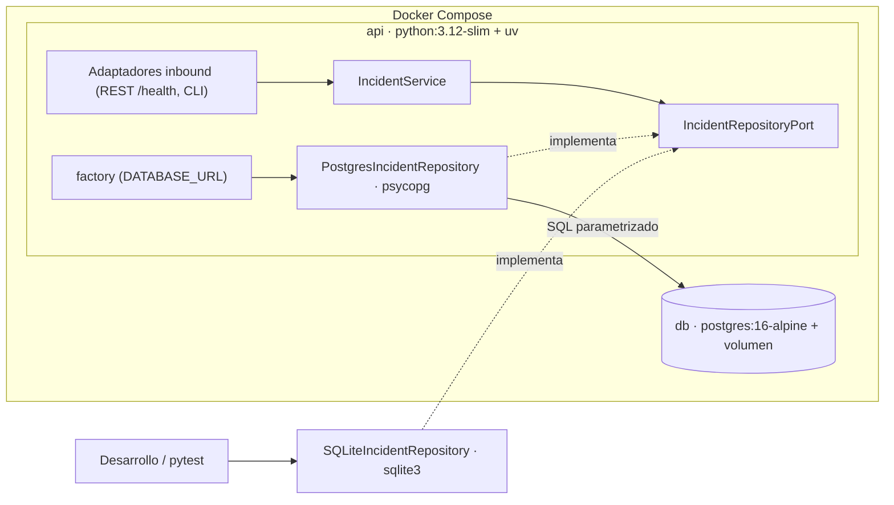

# ADR-004: Persistencia dual SQLite/PostgreSQL sin ORM y runtime multi-contenedor

- **Estado**: Aceptado
- **Fecha**: 2026-11-23
- **Autor(es)**: Equipo IncidentOps
- **Reemplaza a**: `ADR-001` (parcialmente: la restricción de "solo `sqlite3` sin dependencias externas"; se conserva "sin ORMs pesados")

---

## 1. Contexto y Problema

El Hito 004 exige ejecutar IncidentOps en contenedores con una **base de datos relacional dedicada** y un chequeo real de conectividad. ADR-001 limitó la persistencia a `sqlite3` embebido: un archivo local por proceso, un solo escritor y ningún servicio de red, lo que impide separar el ciclo de vida de los datos del de la API y escalar o reiniciar contenedores sin perder estado.

La decisión es estructural y costosa de revertir: introduce un motor y un driver externos, define cómo se representan las fechas en almacenamiento y fija la topología de despliegue. Restricciones vigentes: Arquitectura Hexagonal (ADR-003), sin ORMs pesados, desarrollo y pruebas locales rápidas sin depender de Docker, y cálculo de SLA idéntico sea cual sea el motor.

---

## 2. Opciones Consideradas

1. **Opción A — Mantener solo SQLite embebido dentro del contenedor de la API (volumen montado)**:
   - *Ventajas*: Sin dependencias nuevas ni segundo contenedor; mínima complejidad operativa.
   - *Desventajas*: No es una base dedicada: datos atados a una sola réplica de la API, bloqueo de escritor único y sin chequeo de conectividad significativo; no cumple el objetivo del Hito 004.

2. **Opción B — PostgreSQL con un ORM (SQLAlchemy + Alembic) como único motor**:
   - *Ventajas*: Migraciones gestionadas y portabilidad declarativa entre motores.
   - *Desventajas*: Viola la restricción "sin ORMs pesados"; obliga a levantar PostgreSQL incluso para pruebas unitarias; oculta el SQL optimizado heredado (JOIN + índices compuestos).

3. **Opción C — Persistencia dual SQLite/PostgreSQL sin ORM, seleccionada por `DATABASE_URL`, en topología Docker Compose `api` + `db`**:
   - *Ventajas*: PostgreSQL 16 dedicado (`postgres:16-alpine`) con volumen persistente para producción vía `psycopg[binary]` y SQL parametrizado; SQLite sigue disponible para desarrollo y pruebas sin contenedores; ambos implementan `IncidentRepositoryPort`, así que dominio y casos de uso no cambian; marcas temporales como TEXT ISO 8601 en ambos motores garantizan paridad exacta del cálculo de SLA.
   - *Desventajas*: Dos adaptadores que mantener en paridad; el DDL se duplica por dialecto; fechas en TEXT renuncian a operadores temporales nativos de PostgreSQL; la orquestación añade healthchecks y orden de arranque.

---

## 3. Decisión Arquitectónica

Se elige la **Opción C**. Es la única que entrega una base relacional dedicada sin romper ADR-003 ni la prohibición de ORMs: el cambio queda confinado a un nuevo adaptador secundario y a una fábrica que lo selecciona por `DATABASE_URL` (`postgresql://...` → PostgreSQL; `sqlite:///...` o ausente → SQLite `:memory:`). El runtime de producción es una topología de dos contenedores en la que la API solo arranca cuando la base está sana.

---

## 4. Consecuencias y Trade-offs

- **Positivas**: Datos desacoplados del ciclo de vida de la API; chequeo de salud con una consulta real al motor; dominio y casos de uso intactos (validación directa de ADR-003); las pruebas siguen corriendo en segundos sobre SQLite sin daemon Docker; el SQL permanece explícito y auditable.
- **Negativas / Trade-offs**: Nueva dependencia externa (`psycopg[binary]`) y un segundo adaptador cuya paridad debe probarse contra el mismo puerto; DDL por dialecto sin herramienta de migraciones (cambios de esquema aditivos y manuales); fechas en TEXT limitan consultas temporales en SQL; mayor superficie operativa (credenciales, volúmenes, healthchecks).
